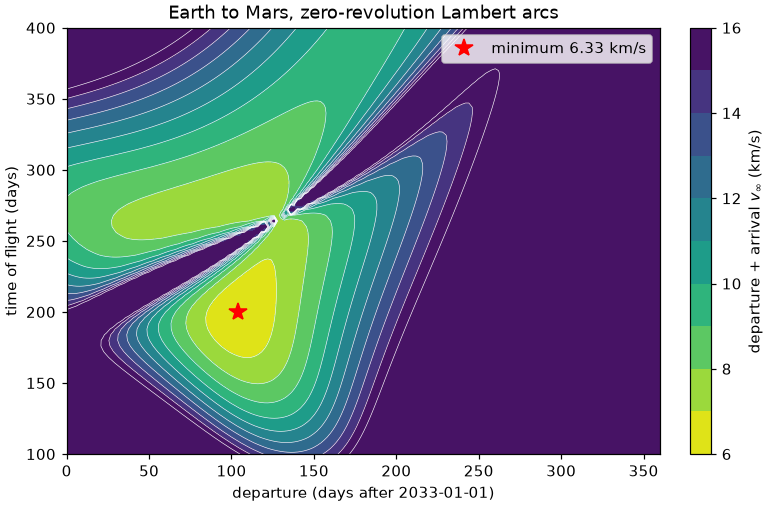
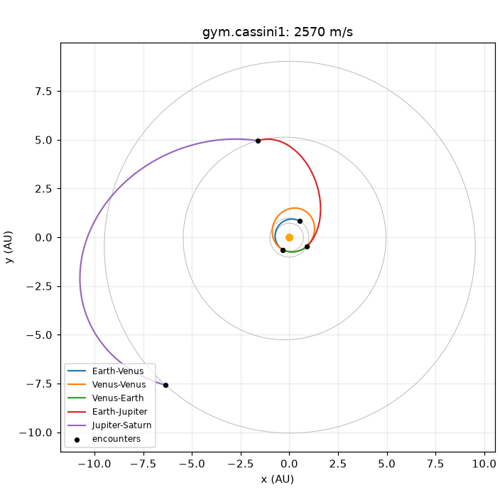

# Astrodynamics for programmers

This chapter is for curious programmers who have never studied orbital
mechanics. It explains the ideas behind interplanetary trajectory design,
from gravity and orbits to gravity assists and low-thrust propulsion, and
shows each one in a few lines of `pykep-rust`. The second half turns those
ideas into optimization problems and solves them with
[fcmaes-rust](https://github.com/dietmarwo/fcmaes-rust). The last two sections
show how an AI agent can run the optimization through
[optimization-jobs](https://github.com/dietmarwo/optimization-jobs), and how
[experiment-craft](https://github.com/dietmarwo/experiment-craft) organizes
repeated runs on one or more machines.

No physics background is assumed beyond "things fall down". Every number
quoted below comes from a script in this repository, so you can rerun and
change it:

```bash
python -m pip install pykep-rust            # 0.1.5 or later includes the gym
python python/examples/astrodynamics_tour.py
```

The tour prints one line per section of this chapter. Its source,
[`python/examples/astrodynamics_tour.py`](https://github.com/dietmarwo/pykep-core-rust/blob/main/python/examples/astrodynamics_tour.py),
is also a handy starting point for your own experiments.

## 1. Gravity and orbits

Every mass attracts every other mass. For a small spacecraft near a much
heavier body, such as the Sun, only the heavy body matters, and the
spacecraft's acceleration points towards it:

```text
acceleration = -μ · r / |r|³        with  μ = G · M
```

`r` is the position relative to the body's center. The single number `mu`,
the *gravitational parameter*, is the gravitational constant times the
body's mass. It is known far more precisely than either factor alone, so
`pykep-rust` uses it directly: `pk.MU_SUN` is about `1.327e20 m³/s²`, and
`pk.MU_EARTH` is about `3.986e14 m³/s²`.

This *two-body problem* has an exact solution. The path is always a conic
section: a circle or ellipse for a bound **orbit**, or a hyperbola for an
object that arrives with enough speed to escape again. Six numbers, the
*classical orbital elements*, describe an orbit and the position on it:

| Element | Symbol | Meaning |
|---|---|---|
| Semi-major axis | `a` | Size: half the longest diameter of the ellipse |
| Eccentricity | `e` | Shape: 0 is a circle, close to 1 a long thin ellipse, above 1 a hyperbola |
| Inclination | `i` | Tilt of the orbital plane against the reference plane |
| Longitude of the ascending node | `Ω` | Where the orbit crosses the reference plane going "up" (for Earth orbits, the right ascension of the ascending node) |
| Argument of periapsis | `ω` | Where in the plane the closest approach (*periapsis*) lies |
| True anomaly | `ν` | Where the object is right now, measured from periapsis |

An equivalent description is the *Cartesian state*: position and velocity,
six numbers `[x, y, z, vx, vy, vz]`. Most algorithms work with states, and
`pykep-rust` converts between the two. Kepler's third law gives the period
of an ellipse, `T = 2π √(a³/μ)`:

```python
import math
import pykep_rust as pk

AU = pk.ASTRONOMICAL_UNIT                      # mean Earth-Sun distance, m
elements = [AU, 0.0167, 0.0, 0.0, math.radians(102.9), 0.0]   # Earth-like
state = pk.classical_to_cartesian(elements, pk.MU_SUN)
period = 2 * math.pi * math.sqrt(AU**3 / pk.MU_SUN)
later = pk.propagate_lagrangian(state, period / 2, pk.MU_SUN)
```

The period is 365.26 days and the speed at periapsis 30.29 km/s. Half a
period later the planet is at its farthest point, the *apoapsis*, at
`a(1 + e) = 1.0167 AU`. `propagate_lagrangian` computes that in closed form
by solving Kepler's equation; no step-by-step simulation is needed while
only one body pulls.

Units are SI throughout: meters, seconds, kilograms, m/s. Dates are
*epochs*, counted in days since 2000-01-01 00:00 (MJD2000). Positions around
the Sun are heliocentric in the ecliptic J2000 frame, whose reference plane
is Earth's orbit. The [numerical conventions](conventions.md) list every
convention.

## 2. Planets move: ephemerides

A trajectory has to meet planets that are themselves moving. An
**ephemeris** is a function from an epoch to a planet's state. `pykep-rust`
ships three: a Keplerian ellipse, JPL's low-precision analytical model for
Mercury to Neptune (1800–2050), and the VSOP2013 theory for higher
accuracy.

```python
epoch = pk.Epoch.from_iso("2033-01-01")
earth = pk.Planet.jpl_low_precision("earth")
mars = pk.Planet.jpl_low_precision("mars")
r_earth = earth.state(epoch.mjd2000)        # [x, y, z, vx, vy, vz]
```

On 2033-01-01 Earth and Mars are 1.852 AU apart. Because the two planets
circle the Sun at different speeds, their relative geometry repeats only
every *synodic period*, about 26 months for Earth and Mars. That is why
Mars missions launch in short **launch windows** roughly two years apart.
See [ephemerides](ephemerides.md) for the providers and their accuracy.

## 3. Changing orbits: impulses and the rocket equation

A rocket changes its velocity by throwing propellant backwards. A short
burn is modeled as an instantaneous velocity change, an **impulse** of size
`Δv` ("delta-v"). Delta-v is the currency of mission design, because the
propellant it costs grows exponentially, as given by Tsiolkovsky's
**rocket equation**:

```text
m_final / m_initial = exp(-Δv / (Isp · g0))        g0 = 9.80665 m/s²
```

The *specific impulse* `Isp` measures engine efficiency, and
`Isp·g0` is the exhaust velocity. For `Δv = 5 km/s`:

| Engine | Isp | Mass left after 5 km/s |
|---|---:|---:|
| Chemical | 320 s | 20.3% |
| Electric (ion) | 3000 s | 84.4% |

Electric engines are ten times more efficient but deliver only a fraction
of a newton of thrust. Section 7 shows why that changes the mathematics.

The textbook two-impulse transfer between two circular orbits is the
**Hohmann transfer**: half an ellipse touching the inner orbit at periapsis
and the outer orbit at apoapsis.

```python
total, duration, impulses = pk.hohmann(AU, 1.524 * AU, pk.MU_SUN)
```

Between orbits of Earth's and Mars's radius it costs 5.60 km/s in two burns
of 2946 m/s and 2650 m/s, and takes 259 days. Real planets are not on
circular coplanar orbits and are rarely in the right place, so practical
design needs something more general.

## 4. Lambert's problem and the porkchop plot

**Lambert's problem** is the workhorse of trajectory design. Given two
positions and a time of flight, find the conic arc that connects them. For
a launch on day `t0` and arrival `T` days later, take Earth's position at
`t0` and Mars's at `t0 + T`, solve Lambert's problem, and compare the
spacecraft's velocities with the planets' velocities. The differences are
the **hyperbolic excess velocities** `v∞`: the speed relative to the
planet, after escaping it or before being captured. The launcher must
provide the departure `v∞`, often quoted as `C3 = v∞²`. The arrival `v∞`
must be removed by a braking burn for a **rendezvous**, when the spacecraft
has to stay with the target, or kept for a **flyby**.

Scanning a grid of launch dates and flight times gives the famous
**porkchop plot**. `pykep-rust` solves independent Lambert problems in
parallel batches:

```python
import numpy as np

DAY = pk.DAY_TO_SECONDS
departures = epoch.mjd2000 + np.arange(0.0, 361.0, 6.0)
flight_days = np.arange(120.0, 361.0, 10.0)
grid = np.array([(t0, tof) for t0 in departures for tof in flight_days])
start = earth.states(grid[:, 0])                  # N x 6, parallel
end = mars.states(grid[:, 0] + grid[:, 1])
problems = pk.lambert_problem_batch(
    np.ascontiguousarray(start[:, :3]), np.ascontiguousarray(end[:, :3]),
    grid[:, 1] * DAY, pk.MU_SUN, maximum_revolutions=0,
)
departure_vinf = [np.linalg.norm(np.subtract(p.solutions[0].departure_velocity, s[3:]))
                  for p, s in zip(problems, start)]
```

The best of the 1,525 arcs leaves on 2033-04-13 and arrives 200 days later,
with `v∞ = 3.00 km/s` at departure and 3.34 km/s at arrival. A finer grid
gives the picture below. The two lobes are the two families of transfers,
shorter and longer than half a revolution. The ridge between them is the
degenerate case of exactly half a revolution, where the transfer plane is
undefined.



`maximum_revolutions` above 0 also returns arcs that circle the Sun several
times before arriving; [examples](examples.md) shows them.

## 5. Flybys and gravity assists

Passing close to a planet bends the spacecraft's path. Seen from the planet,
the spacecraft flies a hyperbola: it arrives and leaves with the same speed
`|v∞|`, but in a different direction. The closer the pass and the heavier
the planet, the larger the turn. A minimum altitude, the *safe radius*,
keeps the spacecraft out of the atmosphere.

Seen from the Sun, this rotation of the relative velocity changes the
spacecraft's heliocentric velocity, because the planet's own orbital
velocity is added back. This is a **gravity assist**: free delta-v, paid for
by an immeasurably small change in the planet's orbit.

```python
venus = pk.Planet.jpl_low_precision("venus")
v_planet = venus.state(epoch.mjd2000)[3:]
v_in = [v + d for v, d in zip(v_planet, [4_000.0, -3_000.0, 500.0])]  # v_inf 5 km/s
v_out = pk.flyby_outgoing_velocity(
    v_in, v_planet, 1.1 * venus.radius, 0.5, venus.body_mu,  # periapsis, plane angle
)
```

Passing at 1.1 Venus radii turns `v∞` by 82.4°. With this orientation of
the turn (`beta = 0.5`), the heliocentric speed rises by 4.29 km/s without
burning propellant; other orientations raise or lower it by different
amounts. When the incoming and
outgoing `v∞` of a planned trajectory differ in magnitude, a burn at closest
approach makes up the difference: a **powered flyby**, whose cost
`pk.flyby_delta_v` returns.

## 6. Multi-leg missions

Cassini reached Saturn by flying past Venus, Venus again, Earth and Jupiter.
Such **multiple gravity assist (MGA)** trajectories chain Lambert arcs, one
*leg* per pair of consecutive planets:

- The decision is the launch epoch plus one flight time per leg.
- Each leg is a Lambert arc between the planets' positions at those epochs.
- At each intermediate planet, the incoming and outgoing `v∞` must match a
  feasible flyby. Any mismatch is paid as a powered-flyby delta-v.
- The objective is the total delta-v: launch excess beyond what the launcher
  provides, all flyby corrections, and the final braking.

**MGA-1DSM** adds one *deep-space maneuver* per leg, a burn somewhere along
the arc. It gives the trajectory more freedom at the price of four more
decision variables per leg. Flight times can also be encoded as fractions
of a total (*alpha* encoding) or of a maximum (*eta* encoding), which makes
some searches easier; see
[impulsive trajectory formulations](trajectory-formulations.md).

The [trajectory gym](trajectory-gym.md) contains 14 such missions from
PyKEP 3.1.0: Cassini in several variants, Earth–Venus–Earth, Rosetta,
Messenger, Earth–Mars with 3, 5 and 7 impulses, and JUICE with a
single-objective and a two-objective version. Every problem has the same
interface:

```python
from pykep_rust.trajopt import gym

cassini = gym.Problem("gym.cassini1")
lower, upper = cassini.get_bounds()        # six decisions, in days
x = [-772.4793517902046, 136.48521715578022, 449.40073064324264,
     57.37453338756138, 948.5084493971979, 4434.572372085129]
cassini.fitness(x)                         # [2569.97...]   total delta-v, m/s
cassini.decode(x)["trajectory"]            # epochs, encounter states, per-encounter delta-v
```

This decision, found by the optimizers of section 9, launches with a
2.1 km/s excess beyond the free launch speed, needs essentially no
correction at the four flybys, and brakes by 461 m/s at Saturn. The flight
takes 16.5 years, because the objective only counts propellant; the
JUICE problems show the trade-off between delta-v and time.



This landscape is rugged. The Venus–Venus leg lasts almost exactly two
Venus years, so its Lambert arc is nearly a full revolution and extremely
sensitive: making it 9 seconds longer raises the total from 2570 to
3433 m/s. Optimizers must cope with many such narrow valleys.

## 7. Low thrust

An electric engine thrusts for months. Its path is no longer a sequence of
conics joined by impulses, so the equations of motion with thrust must be
integrated numerically. Mission design then has to choose the thrust
direction and magnitude over time: an infinite-dimensional choice that
*transcriptions* reduce to finitely many numbers.

The **Sims–Flanagan** transcription divides a leg into segments. Each
segment has a small impulse in its middle, bounded by what the engine could
deliver in that segment, and coasts on conics in between. The leg is
propagated forward from the departure and backward from the arrival, and
the two halves must meet: the *mismatch* in position, velocity and mass at
the cut must be zero.

```python
leg = pk.SimsFlanaganLeg(
    departure_state, 1_500.0,             # state and mass at departure (kg)
    [[0.0, 0.0, 0.0]] * 10,               # throttle vector per segment, |u| <= 1
    mars_state, 1_500.0,                  # state and mass at arrival
    200 * DAY, 0.5, 3_000.0 * pk.STANDARD_GRAVITY, pk.MU_SUN,
)                                         # flight time, max thrust (N), exhaust velocity
leg.mismatch_constraints()                # 7 values that must reach zero
leg.throttle_constraints()                # |u|^2 - 1 <= 0 per segment
leg.mismatch_jacobian()                   # analytic derivatives for gradient solvers
```

With the launcher providing only 2.5 km/s of the 3.0 km/s the Lambert arc of
section 4 needs, and the engine switched off, the leg misses Mars by
35.7 million km and 4.22 km/s. Finding throttles that close this gap, while
using as little propellant as possible, is a constrained optimization
problem.

A **zero-order-hold (ZOH)** transcription keeps the thrust constant on each
segment and integrates the motion with a high-accuracy Taylor integrator.
The gym contains the 68 **TOPS** problems built this way, for four dynamics:
Sun-centered two-body motion in Cartesian or equinoctial coordinates, the
rotating Earth–Moon **circular restricted three-body problem (CR3BP)**
with its halo orbits, and solar sails, which use sunlight instead of
propellant. Each comes with fixed endpoints and with *moving* endpoints on
the departure and target orbits. See [TOPS low-thrust problems](tops.md).

```python
import json
from pathlib import Path

record = json.loads(Path("crates/pykep-trajopt/data/solutions/twobody.P4.json").read_text())
tops = gym.Problem(record["id"], nseg=16)
result = tops.evaluate(record["x"])
```

The bundled solution of `tops.twobody.P4` keeps 50.8% of the initial mass,
and all 23 constraints hold, the largest mismatch being `1.7e-14`.

## 8. Trajectory optimization

All the problems above share one shape:

```text
minimize f(x)   subject to   lower ≤ x ≤ upper,   h(x) = 0,   g(x) ≤ 0
```

`x` is the decision vector (epochs, flight times, throttles), `f` the
objective (delta-v, or final mass with a minus sign), `h` the equality
constraints (mismatches), and `g` the inequality constraints (throttle
limits). The gym follows the PyGMO convention: `fitness(x)` returns the
objectives, then the equalities, then the inequalities, and `get_nec()` and
`get_nic()` count the constraints.

| | Single leg | Multi-leg |
|---|---|---|
| Impulsive | One Lambert arc, two or three variables. The porkchop above is an exhaustive search. | 5–30 variables, many local optima and narrow resonant valleys. No constraints, but a rugged landscape. |
| Low thrust | 30–300 variables, a few equality constraints, smooth. | Long chains of segments, or a global sequence search over low-thrust legs. |

Two families of solvers complement each other:

- **Gradient-free global optimizers**, such as differential evolution (DE),
  CMA-ES and BiteOpt, sample the decision space cleverly and need only
  `fitness`. With many independent restarts they are the method of choice
  for impulsive multi-leg problems.
- **Gradient-based local optimizers**, such as SLSQP or least squares, follow
  derivatives. They converge in a few iterations on smooth, heavily
  constrained low-thrust problems, but only from a good starting point.
  The gym's TOPS problems provide analytic gradients (`problem.gradient(x)`).

Which planets to visit, and in which order, is a discrete choice on top.
In practice it is searched by an outer loop that tries sequences and
optimizes each one, which is exactly the kind of work an agent can
organize; see section 10.

## 9. Solving with fcmaes-rust

[fcmaes-rust](https://github.com/dietmarwo/fcmaes-rust) is a pure-Rust
library of gradient-free optimizers (BiteOpt, DE, CMA-ES, CR-FM-NES, PGPE,
MODE and more) with parallel retry strategies and Python bindings. Install
it next to the pykep-rust wheel:

```bash
python -m pip install fcmaes-rust
python python/examples/gym/optimize_cassini1.py
```

The script runs eight BiteOpt searches with different seeds on Cassini1:

```python
import numpy as np
import fcmaes_rust as fcmaes
from pykep_rust.trajopt import gym

problem = gym.Problem("gym.cassini1")
lower, upper = map(np.asarray, problem.get_bounds())

def delta_v(x):
    try:
        return problem.fitness(x)[0]
    except (ArithmeticError, RuntimeError, ValueError):
        return 1e10        # an impossible geometry is a bad point, not a crash

for seed in range(8):
    x, value, evaluations, _, _ = fcmaes.optimize_bite(
        delta_v, [], lower, upper, seed=seed, max_evaluations=50_000, M=6)
```

Seven of the eight searches stop at 2718.5 m/s, a local optimum; one finds
2570.0 m/s. That is typical: a single run of a global optimizer is a
lottery ticket, so you buy many. The whole loop took about three seconds.
The `try` matters: some decisions inside the bounds describe geometries the
evaluator rejects, such as a flyby that would overflow, and the gym raises
an exception for them.

In Rust, `fcmaes-core` runs the restarts in parallel on all cores. The
example
[`tools/gym-benchmark/examples/cassini1_retry.rs`](https://github.com/dietmarwo/pykep-core-rust/blob/main/tools/gym-benchmark/examples/cassini1_retry.rs)
is complete:

```rust
use fcmaes_core::{BiteParams, RetryBounds, RetryConfig, RetryRunResult, optimize_bite, retry};
use pykep_trajopt::{GymProblem, Problem, TopsOptions};

let problem = GymProblem::new("gym.cassini1", TopsOptions::default())?;
let lower: Vec<f64> = problem.spec().bounds.iter().map(|b| b[0]).collect();
let upper: Vec<f64> = problem.spec().bounds.iter().map(|b| b[1]).collect();
let objective = |x: &[f64]| problem.evaluate(x).map_or(1e10, |e| e.objectives[0]);

let config = RetryConfig { num_retries: 32, workers: 0, max_evaluations: 50_000, seed: 42,
                           ..RetryConfig::default() };
let best = retry(&objective, &RetryBounds::new(lower, upper)?, &config, |objective, context| {
    let result = optimize_bite(objective, context.bounds.lower(), context.bounds.upper(), None,
        &BiteParams { max_evaluations: context.max_evaluations, seed: context.run_seed,
                      ..BiteParams::default() }, 6);
    RetryRunResult { x: result.x, y: result.y, evaluations: result.evaluations }
});
```

```bash
cargo run --release -p pykep-gym-benchmark --example cassini1_retry
```

It reports 2570.0 m/s after 32 runs and 1.6 million evaluations, in under
five seconds on two cores. fcmaes also offers a *coordinated retry*
(`advanced_retry`): later runs get growing budgets and start from crossovers
of the best earlier results, inside local bounds around them. Its
[retry guide](https://github.com/dietmarwo/fcmaes-rust/blob/main/docs/retry.md)
explains it, and its
[GTOP benchmarks](https://github.com/dietmarwo/fcmaes-rust/blob/main/benchmarks/benchmark_gtop.md)
show results on the classic ESA trajectory problems.

Constrained problems need one more step. The gym's command-line driver
turns constraint violations into a penalty, removes coordinates that the
bounds fix, and runs DE, DE followed by CMA-ES, or the multi-objective MODE:

```bash
cargo run --release -p pykep-gym-benchmark -- optimize --problem gym.juice_mo \
  --optimizer mode --evaluations 4096 --seed 42 --output artifacts/gym/juice
cargo run --release -p pykep-gym-benchmark -- validate --run artifacts/gym/juice/run.json
```

`validate` replays the recorded best point and fails if it no longer
matches. For low-thrust problems with many equality constraints, penalties
make gradient-free search slow: in the bounded study of the
[benchmark report](matched-benchmarks.md#optimizer-comparisons), no short
DE-to-CMA run reached feasibility. Use the analytic Jacobian with a
gradient solver instead, as the
[TOPS walkthrough](tops.md#feasible-replay-examples) does with SciPy's
bounded least squares, and keep global optimizers for the outer search over
epochs and flight times.

## 10. Letting an AI agent run the optimization

An AI agent can write and run these scripts directly. For longer studies it
helps to give it a narrower, auditable interface. **optimization-jobs** is
such an interface:

- A **node** is a directory on a machine with a CPU budget.
- **Workers** are registered solver programs, such as `fcmaes-job-worker`.
- A **job** is a JSON document that names a registered worker, a registered
  problem model, an optimizer, a seed and a strict budget. It carries no
  code.
- The result records what was found, how much work it took, and a *claim*
  with its evidence. A gradient-free search claims `best_found`, and the
  worker re-evaluates the reported point.

Through these tools the agent cannot run arbitrary programs or exceed a
budget, and every value in a result was recorded by the worker that computed
it. Setup, following the
[job API guide](https://github.com/dietmarwo/optimization-jobs/blob/main/docs/job-api.md)
(Linux):

```bash
# in a checkout of fcmaes-rust
cargo build --release --locked -p optimization-runner -p fcmaes-job-worker
NODE=$HOME/opt-node
target/release/optimization-run --root $NODE node init --capacity 8
target/release/optimization-run --root $NODE workers add --id fcmaes \
  --executable $PWD/target/release/fcmaes-job-worker
target/release/optimization-run --root $NODE problems describe fcmaes
# give an MCP-capable agent the 15 job tools
claude mcp add optimization-jobs -- $PWD/target/release/optimization-mcp --root $NODE
```

A complete job, from the fcmaes
[job tutorial](https://github.com/dietmarwo/fcmaes-rust/blob/main/tutorials/job-api/README.md):

```json
{
  "schema_version": "optimization.job/0.1",
  "request_key": "tutorial.fcmaes.cassini1.v1",
  "worker": "fcmaes",
  "payload_schema": "fcmaes.retry/1",
  "resources": {"cpu_slots": 8, "outer_workers": 8, "inner_threads": 1},
  "limits": {"wall_time_seconds": 30.0, "grace_seconds": 1.0},
  "inputs": [],
  "payload": {
    "problem": {"id": "gtop.cassini1", "version": "1", "config": {"dimension": 6},
      "bounds": {"lower": [-1000.0, 30.0, 100.0, 30.0, 400.0, 1000.0],
                 "upper": [0.0, 400.0, 470.0, 400.0, 2000.0, 6000.0], "broadcast": false}},
    "optimizer": {"kind": "biteopt", "parameters": {"population": null}},
    "seed": 42, "retries": 16, "evaluations_per_retry": 1000,
    "evaluation_limit_mode": "hard"
  }
}
```

`gtop.cassini1` is the classic ESA GTOP benchmark model built into the
fcmaes worker. It is related to, but not identical with, the gym's
`gym.cassini1`, which follows the current PyKEP definition, and it reports
delta-v in km/s. `optimization-run --root $NODE run --spec cassini1.json`
completes all 16 retries in well under a second; `result JOB_DIRECTORY`
shows each retry's best point with claim `best_found` and evidence level
`rechecked`, the best one at 5.89 km/s.

With the MCP tools connected, a prompt can stay at the level of the
problem, and the agent does the bookkeeping:

> Use the optimization-jobs tools. Describe the fcmaes worker, then run the
> `gtop.cassini1` model with BiteOpt and with CMA-ES (BIPOP restarts),
> seeds 1 to 4, at most 4 CPU slots and 60 seconds per job. Wait for the
> jobs, re-read every result, and report a table of best delta-v, actual
> evaluations and the claim for each run. Do not change budgets to get a
> better number; report failed or cancelled jobs as such.

The optimization-jobs repository has prompt-driven tutorials, including a
[GTOC1 route search](https://github.com/dietmarwo/optimization-jobs/blob/main/tutorials/agentic/gtoc1/README.md)
that screens planet sequences, the discrete layer of section 8.

The gym problems of this book are not yet registered models of a job
worker. Until a pykep worker exists, there are two honest routes:

- Let the agent call `pykep-gym-benchmark optimize` or the Python scripts
  above directly. The `run.json` they write records budget, seed and the
  replayable best point, and `validate` rechecks it.
- Wrap the same command in an `execution.command/0.1` job, which the node
  owner must enable with `optimization-run --root $NODE node commands
  --enable`. It is run from the CLI rather than the MCP server, and its result
  records exit status and output files, without an optimization claim.

A native worker would register gym IDs as fcmaes models, the way the
[GTOC1 application worker](https://github.com/dietmarwo/fcmaes-rust/blob/main/docs/job-api/application-tutorials.md)
registers its route model.

## 11. Many runs, many machines: experiment-craft

A serious study repeats each optimization with many seeds, optimizers and
budgets. **experiment-craft** composes such *campaigns* from
optimization-jobs envelopes. A campaign declares a total budget and steps
with an optional parameter *matrix*; each matrix entry becomes one job:

```json
{
  "schema_version": "experiment.campaign/0.1",
  "name": "Cassini1 seed sweep",
  "budget": {"max_jobs": 8, "max_wall_seconds": 600, "max_reserved_slot_seconds": 2000},
  "steps": [{
    "id": "biteopt",
    "job": {
      "schema_version": "optimization.job/0.1",
      "worker": "fcmaes",
      "payload_schema": "fcmaes.retry/1",
      "resources": {"cpu_slots": 4, "outer_workers": 4, "inner_threads": 1},
      "limits": {"wall_time_seconds": 60.0, "grace_seconds": 1.0},
      "inputs": [],
      "payload": {
        "problem": {"id": "gtop.cassini1", "version": "1", "config": {"dimension": 6},
          "bounds": {"lower": [-1000.0, 30.0, 100.0, 30.0, 400.0, 1000.0],
                     "upper": [0.0, 400.0, 470.0, 400.0, 2000.0, 6000.0], "broadcast": false}},
        "optimizer": {"kind": "biteopt", "parameters": {"population": null}},
        "seed": 42, "retries": 16, "evaluations_per_retry": 1000,
        "evaluation_limit_mode": "hard"
      }
    },
    "matrix": {"/payload/seed": [1, 2, 3, 4, 5, 6, 7, 8]},
    "accept": {"claims": ["best_found"]}
  }]
}
```

The campaign compiler assigns the request keys, so the job omits
`request_key`. A slot-second is one declared CPU slot for one second of wall
time and grace, so eight jobs of four slots and 61 seconds reserve
1,952 slot-seconds. Run and inspect it with the JSON command-line tool:

```bash
experiment-craft dry-run campaign.json
experiment-craft run campaign.json --workspace $HOME/campaigns/cassini1 \
  --runner $PWD/target/release/optimization-run --node-root $NODE --mode foreground
experiment-craft status --workspace $HOME/campaigns/cassini1
experiment-craft report --workspace $HOME/campaigns/cassini1 --destination $HOME/reports
experiment-craft dashboard --workspace $HOME/campaigns/cassini1 --state-dir $HOME/dashboard
```

`report` writes `report.json`, `results.csv` and `report.md` from the
recorded results, including failed and cancelled steps. In a test run on a
two-core machine all eight jobs succeeded. `results.csv` had 128 rows, one
per retry; the best value per seed ranged from 5.60 to 11.2 km/s. The best
known Cassini1 solution needs 4.93 km/s (see the fcmaes
[GTOP benchmarks](https://github.com/dietmarwo/fcmaes-rust/blob/main/benchmarks/benchmark_gtop.md)),
so 1,000 evaluations per retry are
far too few: the campaign makes that visible before anyone draws a
conclusion. The dashboard
serves a browser page on `127.0.0.1:8765` with start, pause and stop
controls and progress charts for up to 32 campaign workspaces. On a remote
machine, forward it with `ssh -L 8765:127.0.0.1:8765 host` and open the
printed URL locally.

Several machines are supported at two levels today:

- **One campaign per machine.** Each machine has its own node and campaign
  workspace; split the matrix between them, monitor each machine's
  dashboard, and merge the reports.
- **Explicit placement.** optimization-jobs can submit a job to another
  registered node over SSH with `optimization-run fleet submit --node NAME
  --spec JOB.json`, and follow it with `fleet get`, `fleet reconcile` and
  `fleet execution`. It requires an SSH key, a pinned host key and a systemd
  user manager with lingering on the remote host.
  `experiment-craft deployment-export` turns a machine inventory into the
  exact setup, registration and probe commands for each node, without
  running them.

Automatic routing of one campaign across machines is not implemented yet:
experiment-craft refuses a remote campaign target. The
[deployment guide](https://github.com/dietmarwo/experiment-craft/blob/main/docs/deployment.md)
and the [dashboard reference](https://github.com/dietmarwo/experiment-craft/blob/main/docs/dashboard.md)
describe the current state. The dashboard charts declared slots and step
counts, not measured CPU use.

For an agent, the same commands form a complete loop: write the campaign,
run `dry-run`, start it, poll `status` and `events`, and summarize
`report.json`. Each step's claims and evidence come from optimization-jobs,
and the report keeps them separate from any conclusion the agent draws.

## Glossary

| Term | Meaning |
|---|---|
| Apoapsis / periapsis | Farthest / closest point of an orbit from the central body |
| C3 | Square of the departure hyperbolic excess speed, the launcher's figure of merit |
| CR3BP | Circular restricted three-body problem: a spacecraft moving under two bodies on circular orbits, such as Earth and Moon |
| Delta-v (Δv) | Velocity change produced by propulsion; its propellant cost follows the rocket equation |
| Deep-space maneuver (DSM) | An impulse between two planetary encounters |
| Ephemeris | Function giving a body's position and velocity at an epoch |
| Epoch | A point in time; here days since 2000-01-01 (MJD2000) |
| Flyby / gravity assist | A close pass that rotates the relative velocity and changes the heliocentric velocity |
| Gravitational parameter (μ) | Gravitational constant times mass |
| Halo orbit | A periodic three-dimensional orbit near a Lagrange point of the CR3BP |
| Hyperbolic excess velocity (v∞) | Velocity relative to a planet far from it, before capture or after escape |
| Impulse | Instantaneous model of a short burn |
| Lambert's problem | Find the orbit connecting two positions in a given time |
| Launch window | Period in which the planetary geometry allows a transfer at acceptable cost |
| MGA, MGA-1DSM | Multiple gravity assist trajectory, without or with one DSM per leg |
| Orbital elements | Six numbers describing an orbit's size, shape, orientation and position |
| Porkchop plot | Map of launch cost over departure date and flight time |
| Rendezvous | Arriving at a target with matching velocity |
| Sims–Flanagan | Low-thrust transcription with one bounded impulse per segment |
| Specific impulse (Isp) | Engine efficiency in seconds; exhaust velocity divided by g0 |
| TOPS | Benchmark set of low-thrust problems with piecewise-constant thrust |
| Zero-order hold (ZOH) | Constant control on each segment, integrated numerically |

## Where to go next

- [Examples and quick starts](examples.md) has the Rust versions of most
  snippets.
- [Trajectory optimization gym](trajectory-gym.md), [TOPS](tops.md) and
  [impulsive formulations](trajectory-formulations.md) document every
  problem.
- [Sims–Flanagan legs](low-thrust-legs.md) and [ZOH legs](zoh-leg.md)
  explain the low-thrust transcriptions and their derivatives.
- The optional [heyoka high-fidelity check](https://github.com/dietmarwo/pykep-core-rust/blob/main/python/examples/heyoka/README.md)
  verifies the Cassini1 route of section 6 in a VSOP2013 model with
  planetary perturbations, and finds the fragile Venus–Venus leg.
- [fcmaes-rust examples](https://github.com/dietmarwo/fcmaes-rust/blob/main/docs/examples.md)
  and its [GTOC1 tutorial](https://github.com/dietmarwo/fcmaes-rust/blob/main/tutorials/gtoc1/README.md)
  go further with real competition problems.
- The [optimization-jobs AI context](https://github.com/dietmarwo/optimization-jobs/blob/main/ai-context.md)
  is the entry point an agent should read before using the job tools.
