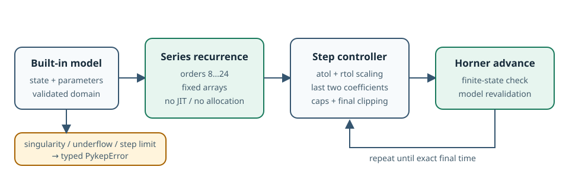
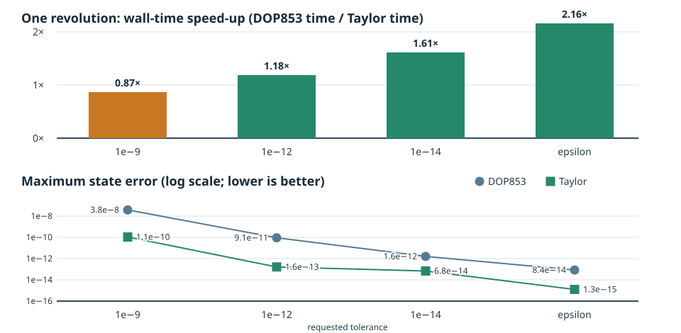

# High-accuracy Taylor integration

The [current benchmark report](matched-benchmarks.md) compares all eleven
built-in nominal fixtures with warmed native heyoka under a shared
endpoint-error gate. It gives separate results for full ZOH-leg Jacobians
and the Python trajectory gym.

`pykep-core` has two pure-Rust adaptive integration backends:

- `Taylor` is the default for the eleven built-in dynamics types, matching
  upstream pykep's `ta` model families. It is most useful near `1e-14` and
  below, or when long-term invariant drift matters more than minimum
  low-accuracy wall time.
- `Dop853` accepts arbitrary `DynamicsModel` implementations, supports event
  location, and remains the general-purpose choice.

The Taylor backend specializes its coefficient recurrences for the built-in
astrodynamics equations. Ordinary builds compile the checked-in Rust kernels.



## What the backend computes

For a state expanded around the current time,

\\[
x(t+h)=\sum_{k=0}^{p}x_kh^k,
\\]

the model recurrence constructs coefficients through order `p`. Products use
Cauchy convolution; real powers, square roots, exponentials, sine, and cosine
use coefficient recurrences. The controller:

1. selects order 8–24 from the requested tolerance;
2. scales the final two coefficients by
   `atol + rtol * max(abs(state), 1)`;
3. chooses a conservative step from both coefficient estimates;
4. applies initial and maximum step caps;
5. clips the final step exactly to the requested time.

Backward propagation uses the same coefficients with a negative step. Every
accepted state is checked for finite values and revalidated against the model
domain. A zero or non-advancing floating-point step is reported as underflow.

The implementation follows the recurrence and step-selection ideas described
by Jorba and Zou, while being written independently for fixed Rust arrays:
[A software package for the numerical integration of ODEs by means of
high-order Taylor methods](https://eudml.org/doc/53069).

## Selecting the backend

`KeplerDynamics::propagate()`, the corresponding CR3BP and BCP convenience
methods, and `AdaptiveIntegrator::default()` select Taylor. The method can
also be stated explicitly:

```rust
use pykep_core::dynamics::KeplerDynamics;
use pykep_core::integration::{IntegrationMethod, IntegratorOptions};

let result = KeplerDynamics.propagate_with_method(
    0.0,
    [0.8, -0.2, 0.1, 0.03, 1.0, 0.02],
    0.5,
    1.0,
    IntegratorOptions {
        relative_tolerance: 1e-14,
        absolute_tolerance: 1e-14,
        ..IntegratorOptions::default()
    },
    IntegrationMethod::Taylor,
)?;
assert_eq!(result.time, 0.5);
# Ok::<(), pykep_core::PykepError>(())
```

The lower-level `Taylor` and `AdaptiveIntegrator` facades also provide final,
dense-grid, and seeded-sensitivity propagation. ZOH schedules have parallel
`*_with_method` functions.

Taylor dense output samples the accepted-step polynomial and uses the same
adaptive steps as final-state propagation. A ZOH control boundary still ends
the segment and its polynomial. On baseline x86 builds, interior samples use
separate multiply and add in Horner evaluation to avoid repeated FMA helper
calls. Nonfinite results are reevaluated with fused arithmetic.

Use `Taylor::propagate_until_event` for a terminal plane, sphere, or radial
stationary point on a built-in Cartesian model. `Taylor::propagate_with_events`
records crossings without modifying the trajectory and takes an explicit
event limit. Crossing direction follows propagation order, including for
backward integration. Root isolation works on the truncated event polynomial
and reports ambiguous near-stationary roots as integration errors.
Use `Dop853::propagate_until_event` for a general callback or external model.

`Taylor::propagate_batch` preserves input order and the existing worker
policy. The optional `simd` feature evaluates four Kepler, CR3BP, BCP, or
ZOH Kepler coefficient jets together. Each lane has its own time and step
size. The vector kernel extracts the coefficient tails for step selection and
evaluates the new states directly from the vector jet. Other models and
partial groups use scalar propagation.

## Supported models

The nine upstream equation families produce eleven concrete Rust types:

| Family | Rust type |
|---|---|
| Cartesian Kepler | `KeplerDynamics` |
| CR3BP | `Cr3bpDynamics` |
| Bicircular problem | `BcpDynamics` |
| ZOH Cartesian Kepler | `ZohKeplerDynamics` |
| ZOH CR3BP | `ZohCr3bpDynamics` |
| ZOH equinoctial | `ZohEquinoctialDynamics` |
| ZOH solar sail | `ZohSolarSailDynamics` |
| Cartesian Pontryagin | `CartesianMassOptimal`, `CartesianTimeOptimal` |
| Equinoctial Pontryagin | `EquinoctialMassOptimal`, `EquinoctialTimeOptimal` |

Singular points stay errors. Examples include collisions, zero Pontryagin
primer norm, non-positive mass, and a zero equinoctial radial denominator.
The series backend does not smooth or silently cross these non-analytic model
boundaries.

## Measured crossover

The fixed benchmark uses the eccentric nondimensional state
`[0.5, 0, 0, 0, sqrt(3), 0]`, one revolution, release mode, and analytical
Lagrange propagation as the error reference.



| tolerance | DOP853 | Taylor | Taylor speed-up | max error, DOP853 | max error, Taylor |
|---:|---:|---:|---:|---:|---:|
| `1e-9` | 14.96 µs | 17.22 µs | 0.87× | `3.80e-8` | `1.08e-10` |
| `1e-12` | 28.62 µs | 24.17 µs | 1.18× | `9.13e-11` | `1.65e-13` |
| `1e-14` | 44.77 µs | 27.80 µs | 1.61× | `1.60e-12` | `6.84e-14` |
| machine epsilon | 71.31 µs | 33.03 µs | 2.16× | `8.39e-14` | `1.25e-15` |

These are measurements on one development host, not portable promises. The
100- and 1,000-revolution rows and all raw counters are in
[`data/taylor-kepler-benchmark.csv`](data/taylor-kepler-benchmark.csv).
Taylor coefficient sweeps and DOP853 RHS calls are different work units, so
wall time at matched accuracy—not the work-counter ratio—is the meaningful
comparison.

Reproduce the data with:

```bash
cargo run --release -p pykep-taylor-benchmark \
  > docs/data/taylor-kepler-benchmark.csv
python tools/taylor_results_svg.py   # redraws docs/images/taylor-results.svg
```

## Incremental coefficient evaluators

All eleven built-in models advance only the next required Taylor coefficient.
Kepler and ZOH Kepler use handwritten scalar recurrences. Solar sail uses
its incremental tape for nominal propagation. CR3BP uses generated Rust
through order 18 and its tape at higher orders. The other seven models use
checked-in generated Rust. Generated kernels also supply the tangent and SIMD
recurrences.

The generator reuses the model graphs, prunes unreachable nodes while
retaining trigonometric companions, and specializes products with factors
constant in time. Such factors can still carry parameter derivatives. State
histories are read from the solution jet, and local values hold intermediate
coefficients that are used only at the current degree. Recurrence operands
retain their coefficient histories. Run `python tools/taylor-codegen/regenerate.py --report layout.json`
from the repository root to inspect the emitted row counts.

The nominal step safety factor is 0.85 for CR3BP, solar sail, and the two
equinoctial Pontryagin models. The other nominal paths and the augmented
sensitivity controller use 0.75. Accuracy and performance for the expanded
fixture corpus are documented in the [Taylor performance follow-up](taylor-performance-followup.md).

The following timings describe the 0.1.4 migration to incremental
recurrences.

The table records the eight final migrations against the previous repeated
full-series evaluator at commit `c9ecd17`. Each row is an end-to-end
propagation at `1e-12`, pinned to one core, with 1,000 iterations per sample
and the median of seven warmed samples:

| model | previous | incremental | speed-up |
|---|---:|---:|---:|
| CR3BP | 158.102 µs | 21.515 µs | 7.35× |
| bicircular problem | 104.921 µs | 16.257 µs | 6.45× |
| ZOH CR3BP | 51.266 µs | 6.791 µs | 7.55× |
| ZOH equinoctial | 49.683 µs | 6.979 µs | 7.12× |
| ZOH solar sail | 91.894 µs | 12.876 µs | 7.14× |
| Cartesian time-optimal | 124.124 µs | 4.285 µs | 28.97× |
| equinoctial mass-optimal | 7.696 ms | 377.991 µs | 20.36× |
| equinoctial time-optimal | 7.797 ms | 333.640 µs | 23.37× |

These development-host measurements establish that every migration cleared
the significance gate; they are not portable latency guarantees. Matching
final-state checksums and the validation layers below guard the optimization.
Criterion entries under `taylor/*` keep all eight paths visible in routine
performance runs.

## Sensitivities and validation boundaries

`Taylor::propagate_with_sensitivities()` computes the continuous first
variations from tangent coefficients. Up to 16 seed directions share one
nominal coefficient evaluation in a dual jet. Wider seed matrices use
four-direction blocks to bound kernel scratch space. Step selection includes
the nominal state and every sensitivity component. Baseline x86 builds use
separate multiply and add to evaluate derivative polynomials, with fused
reevaluation for nonfinite results.
`ZohLeg::mismatch_jacobian_with_method(IntegrationMethod::Taylor)` composes
the segment sensitivities into endpoint, control, and time-grid derivatives.

For Pontryagin systems, stop-gradient boundaries are applied when forming
the Hamiltonian costate equations. Tangent propagation differentiates the
resulting closed-loop equations, including the control dependence.
Taylor sensitivities use fixed end times. Event-time and reset derivatives
are outside this API.

Validation has three independent layers:

- closed-form tests for series products, real powers, trigonometric functions,
  exponentials, and square roots;
- fixed DOP853 comparisons for all eleven concrete dynamics types, including
  all four Pontryagin variants;
- a development-only official-heyoka harness for Kepler, CR3BP, BCP, and a
  Kepler STM.

The heyoka fixture records version `7.10.1` and is regenerated with
`tools/heyoka-cross-validation/generate.py`. It is intentionally not a normal
CI dependency. The larger ZOH and Pontryagin families use the existing pinned
upstream pykep fixtures plus DOP853 comparisons; they are not presented as
direct heyoka cross-checks.

## Regenerating the kernels

Run the generator from a workspace with the supported Rust toolchain:

```bash
python tools/taylor-codegen/regenerate.py
python tools/taylor-codegen/regenerate.py --check
```

The ignored Rust exporter serializes private model graphs, and the developer
tool emits and formats the Rust module. An ordinary crate or wheel build
uses the checked-in source. The tape and full-series tests provide reference
evaluators. See [the comparison instructions](https://github.com/dietmarwo/pykep-core-rust/blob/main/tools/taylor-comparison/README.md)
for reproducible native and Python timings.

## Population, history, and shooting workflows

For a BCP population, create one `InitialValueProblem<6, 4>` per candidate.
Keep the rotating-frame Cartesian state order `[x, y, z, vx, vy, vz]` and
the BCP parameter order `[mu, mu_sun, rho_sun, omega_sun]`. Each candidate can
have its own time interval. With a pool already supplied by the optimizer,
use one inner worker.

```rust
use pykep_core::dynamics::BcpDynamics;
use pykep_core::integration::{InitialValueProblem, IntegratorOptions, Taylor};

let jobs = [0.12, 0.20, 0.25, 0.30].map(|time| {
    InitialValueProblem::new(
        0.0, [0.8, -0.2, 0.1, 0.03, -0.04, 0.02], time,
        [0.01215058560962404, 328900.56, 389.172, -0.925195985520347],
    )
});
let states = Taylor.propagate_batch(&BcpDynamics, &jobs, IntegratorOptions::default(), 1)?;
# assert_eq!(states.len(), 4);
# Ok::<(), pykep_core::PykepError>(())
```

Use the same rotating-frame scales for every position, velocity, and time in
a batch. Validate several population endpoints with a tighter scalar solve.
The `model_comparison` binary includes balanced and mixed-duration batches
using this fixture.

For a normalized low-thrust Cartesian leg, request
`leg.state_history_with_method(101, IntegrationMethod::Taylor)`. The
returned forward and backward histories each contain one list per propagated
segment. Both endpoints belong to each segment's sampled list. Positions,
velocities, mass, and time use the scales declared when constructing the leg.
Compare interior points against independent endpoint solves with the same
control over the corresponding subinterval.

For single shooting, construct a `SensitivityProblem` with one column per
decision variable. An initial-velocity seed puts a one in that component
of `initial_sensitivities`. A gravity-parameter seed goes into
`parameter_seeds`. Use the propagated state to form the endpoint residual
and select the same state rows from the returned sensitivity matrix for the
Jacobian. For a ZOH leg, the complete mismatch Jacobian can be requested
directly with `mismatch_jacobian_with_method(IntegrationMethod::Taylor)`.
Check the assembled Jacobian against a small perturbation of the complete
problem, particularly when a variable moves a shared control boundary.
